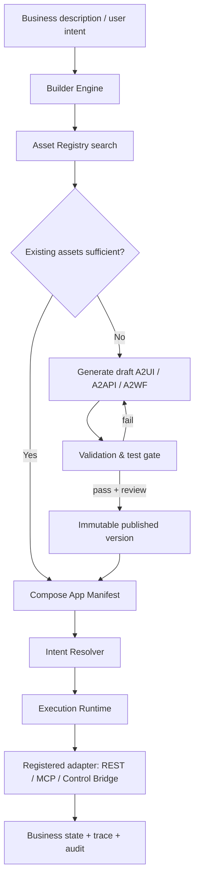

# Architecture

## Runtime pipeline

## Asset kinds

- **A2UI**: declarative component description. Runtime renders only registered component types; JSON cannot contain executable JavaScript or arbitrary remote code.
- **A2API**: business capability contract: input/output schemas, errors, roles, tenant requirement, preconditions, effects, adapter mapping, timeout and idempotency.
- **A2WF**: trigger and ordered steps that reference published components and capabilities.
- **App Manifest**: role entrypoints and pinned asset versions.

A2API is the project's business capability contract, not a claim of an official Google standard. It complements OpenAPI, MCP and existing service APIs.

## Publication lifecycle

`draft -> validated -> testing -> published -> deprecated`

Published versions are immutable. Changes create a new version. Production resolution reads published versions only. Publication requires a test evidence record with at least one pass and zero failures. A future validation service will add schema compatibility, adapter contract tests, permission matrix, timeout/retry, security and load tests.

## Trust boundaries

1. Natural language and model output are untrusted input.
2. Client-provided roles and tenant IDs are never authoritative; the API gateway must construct identity from a verified session/token.
3. Adapter names are resolved only from a server-side allowlist. Never evaluate arbitrary code or URLs from asset JSON.
4. Write operations require idempotency keys. Refunds, payments, deletion and other high-impact operations need explicit confirmation and audit.
5. Business state is the source of truth. Chat history is only an interaction log and references durable business records.
6. Draft/test assets must be isolated from production execution.

## Integration

The runtime deliberately does not replace the existing business control plane. Register a server-side adapter such as `control-bridge` that forwards an allowlisted operation to the existing MCP/control service. Merchant, staff, consumer and platform-admin clients share the same capability definitions; the server enforces identity, tenant and role policies.
